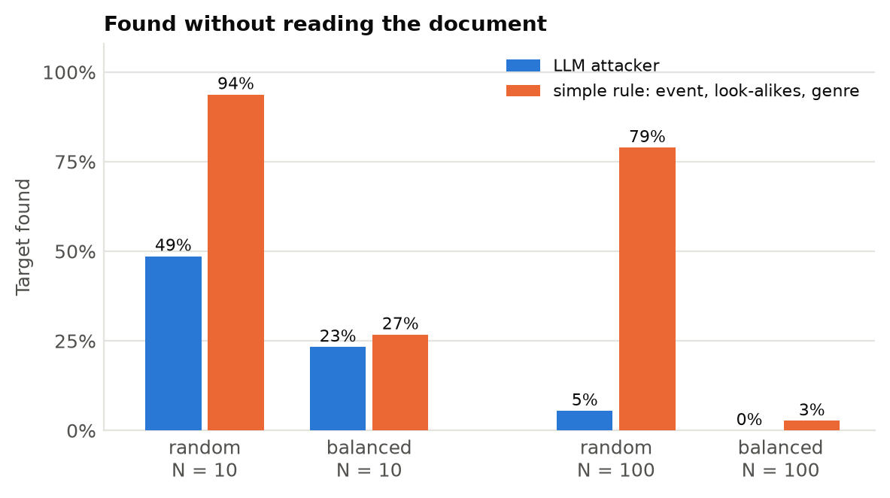

# Attacks

Recall says how much of the gold annotation a masker hides. The attacks measure what is left for someone who reads the text: can they tell who it is about, and what do they learn about that person. All people, documents and profiles are fictional.

## Threat model

The attacker is a large language model with a closed list of candidates. It gets a masked document and N one-line profiles (N = 10 or 100) and knows that the document is about one of them. A profile holds the full name in the nominative, gender, birth year, oblast and settlement, occupation, family status, number of children and, for some people, an event with its year (a lawsuit, an award, a grant, a dismissal).

This is a strong attacker on purpose: it has complete background data and a short list. Success rates are therefore not estimates of risk in the open world. They are used to compare maskers and conditions under the same attack.

## Tasks

| Task | Input | Output | Use |
|---|---|---|---|
| Re-identification | masked document and N profiles | the five most likely people | top-1 and top-5 accuracy |
| No-document baseline | the same N profiles, no document | the five most likely people | how much the list alone gives away |
| Attribute inference | masked document, no profiles | gender, decade of birth, oblast, occupation | what leaks without naming anyone |

Re-identification and attribute inference run on 146 documents in 12 versions: three masking systems (rule-based, spaCy NER, Qwen3-32B) and nine controlled conditions. The unmasked text is attacked as well; if the attack failed there, it would say nothing about masking.

## Candidate lists

A list always holds the target and all of their look-alikes: one to three people of the same gender, birth year, oblast and occupation. The question is how to fill the rest.

Random people are the obvious choice, and they break the measurement. Every target has an event and look-alikes, while about 10% of the other people have an event and few have look-alikes. "The one with an event and look-alikes" is nearly always the target, without reading a word of the document.

The main design, `balanced`, fills a list with whole groups of other targets of the same genre, each with its own look-alikes, so that everyone who stands out stands out for the same reason. No group is cut, since a target without look-alikes would be recognisable as a filler. Target positions are spread evenly over the lists.

Top-1 without the document:

| Lists | Who guesses | N = 10 | N = 100 |
|---|---|---|---|
| chance | | 10.0% | 1.0% |
| `random` | rule (event, look-alikes, genre) | 93.7% | 78.9% |
| `random` | the attacker | 48.6% | 5.5% |
| `balanced` | rule (event, look-alikes, genre) | 26.7% | 2.7% |
| `balanced` | the attacker | 23.3% | 0.0% |

Balanced lists are still not at chance: a list of 10 holds three to five groups. N = 100 is therefore the main setting, and results are compared with the no-document baseline rather than with 1/N. Top-5 at N = 10 is not informative, because the baseline already reaches 97.3%.

## Attacker

- **Model:** `openai/gpt-oss-120b`, served with vLLM 0.33 on one A100 80 GB, 16k context, up to 8,000 tokens per reply including reasoning. It is neither the generator of the documents (Gemma 4 31B) nor the model behind the LLM masker (Qwen3-32B).
- **Prompts:** `docs/prompts/attack_reid_v1.md` and `attack_attr_v1.md`. They say who the main person is (the claimant, the subject of the article, the author of the post), what placeholders look like, and that names can appear in any case, as a patronymic, a diminutive, initials or a Russian spelling. The genre, the document year and the masker are not given. Candidates carry labels (`C001`…), not person ids.
- **Sampling:** temperature 0. A reply that is unreadable, too short or names a label outside the list is repeated up to twice at 0.7. A label outside the list keeps its place in the ranking as a miss. Of 7,446 calls, 42 needed a second attempt and none stayed unreadable.
- **Prompt choices** were made on the 30-document sample and frozen before the full run. The reply limit was raised from 4,000 to 8,000 tokens there, because at N = 100 several replies ended in the middle of the reasoning.

## Scoring

- Accuracy is reported with 95% bootstrap intervals over documents (2,000 draws).
- In attribute inference, oblast and occupation are closed lists and scored by exact match. "unknown" is allowed and counts as wrong. The comparison is with always guessing the commonest value.
- After the manual check changed the annotation of 26 documents and dropped one, only the affected texts were attacked again. Rows carry a hash of the prompt, so stale answers are recognised.

Code: `evaluation/candidates.py`, `prompts.py`, `run_attacks.py`, `score.py`, `plots.py`; commands in `evaluation/README.md`.

## Limitations

- **Closed world.** The target is always in the list and the profiles are complete.
- **One attacker model.** A stronger one could extract more, so the results are a lower bound for this threat model.
- **Not fully deterministic.** Repeated runs at temperature 0 differ by a few documents.
- **Synthetic text.** The documents are short and come from one generator.
- **Profiles contain the event.** This is what makes a document about a lawsuit or an award traceable; an attacker without such records would do worse.
- **The `clues` field is not evidence.** The model writes it together with the answer and sometimes lists facts of the chosen profile that are masked in the text. It is useful for reading errors, not for explaining successes.
- **No document year.** An age alone cannot be turned into a birth year, while k-anonymity uses the year.
