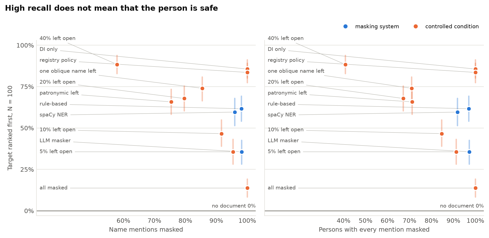
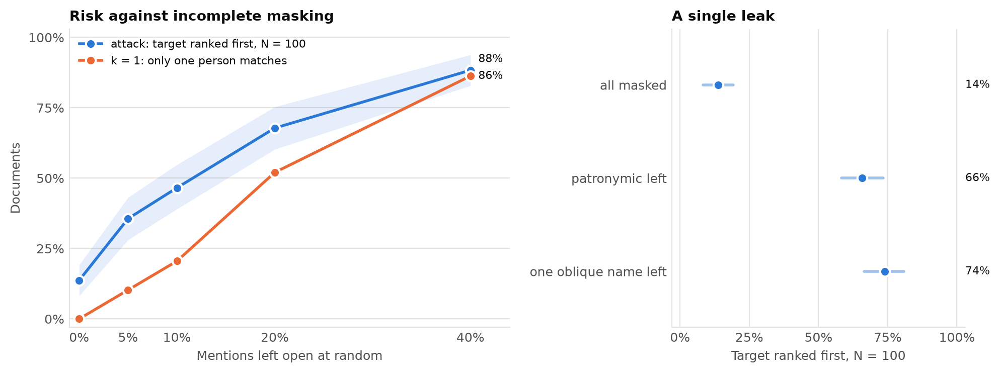
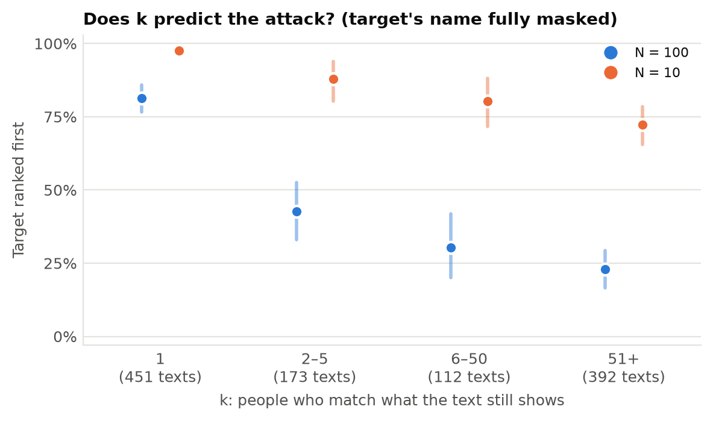
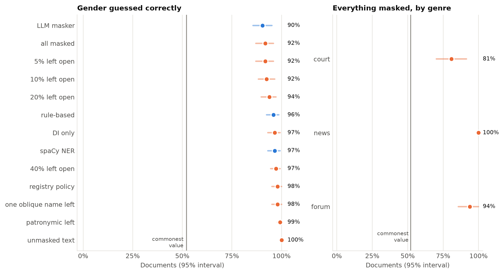

# Results

146 documents (50 news, 49 forum, 47 court), 12 masked versions each, N = 100 unless stated. Brackets hold 95% bootstrap intervals over documents; with 146 documents they are about ±8 points wide around 50%, so small differences are not interpreted. Tables: `data/full/results/`. Method: `attacks.md`.

## Checks

| | N = 100 | N = 10 |
|---|---|---|
| No document | 0.0% | 23.3% |
| Unmasked text | 99.3% | 100% |

Without the text the attacker finds nobody among 100 candidates, and with the full text it finds nearly everyone. What lies between comes from the text.

## Overview

Name mentions, persons and QI are recall by the open-mention rule. Persons counts people with every mention masked. Top-1 is re-identification.

| Version | Name mentions | Persons | QI | k = 1 | Top-1, N = 100 | Top-1, N = 10 | Gender |
|---|---|---|---|---|---|---|---|
| all masked (`gold_full`) | 100 | 100 | 100 | 0.0 | 13.7 [8.2–19.2] | 70.5 | 91.8 |
| DI only | 100 | 100 | 0.0 | 91.1 | 85.6 [80.1–91.1] | 98.6 | 96.6 |
| registry policy | 100 | 100 | 3.8 | 89.0 | 83.6 [77.4–89.0] | 97.9 | 97.9 |
| one oblique name left | 85.5 | 71.0 | 100 | 35.6 | 74.0 [66.4–80.8] | 92.5 | 97.9 |
| patronymic left | 75.4 | 71.2 | 100 | 0.0 | 65.8 [58.2–73.3] | 97.3 | 99.3 |
| 5% left open | 95.4 | 91.3 | 95.3 | 10.3 | 35.6 [28.1–43.2] | 76.0 | 91.8 |
| 10% left open | 91.7 | 84.7 | 90.3 | 20.5 | 46.6 [39.0–54.8] | 82.9 | 92.5 |
| 20% left open | 79.6 | 67.2 | 81.6 | 52.1 | 67.8 [60.3–75.3] | 91.1 | 93.8 |
| 40% left open | 58.0 | 40.8 | 62.9 | 86.3 | 88.4 [82.9–93.8] | 97.3 | 97.3 |
| rule-based | 98.1 | 97.0 | 50.0 | 65.8 | 61.6 [54.1–69.2] | 91.8 | 95.9 |
| spaCy NER | 95.9 | 91.8 | 56.5 | 60.3 | 59.6 [51.4–67.8] | 93.2 | 96.6 |
| LLM masker | 98.2 | 97.2 | 58.5 | 22.6 | 35.6 [28.1–42.5] | 82.9 | 90.4 |

All values are percentages. The k = 1 shares of the three systems are upper bounds, see "Limitations".

## RQ1: does recall hide person-level failure?

Yes.

- The rule-based masker hides 98.1% of name mentions and every mention of 97.0% of the people. The attacker still finds the target in 61.6% of the documents.
- The rule-based and the LLM masker cannot be told apart by name recall (98.1% and 98.2%), but the attacker succeeds in 61.6% against 35.6% of the documents, with intervals that do not overlap.
- Registry-style masking hides every name and only 3.8% of the quasi-identifiers. The attacker finds 83.6%.

Entity-level recall is stricter than mention-level recall, but both look at names. Neither sees the quasi-identifiers, which decide the outcome once the names are gone.

## RQ2: how does risk grow with incomplete masking?

Not linearly: the first few misses cost the most. Leaving 5% of the mentions open moves top-1 from 13.7% to 35.6%. In the 71 documents where this left at least one mention open, it is 54.9%; at 10% it is 55.0% in 109 documents.

Single leaks:

- **One oblique name mention** left open: 74.0%, although 85.5% of the name mentions are masked.
- **The patronymic alone**: 65.8%, although no document has k = 1 and the median k is 35. k counts matches among 2,000 people, while the attacker chooses among 100. In such a list three people share the target's patronymic (median), and in 62% of the lists the target is the only one of them with the same type of event.

## RQ5: who stays identifiable when all names are masked?

Most people. With registry-style masking 89.0% of the documents match exactly one person in the population, with only direct identifiers masked 91.1%. The attacker finds 83.6% and 85.6%.

k predicts the attack where the target's name is fully masked (all versions pooled):

| k | Texts | Top-1, N = 100 | Top-1, N = 10 |
|---|---|---|---|
| 1 | 451 | 81.4 [76.7–85.9] | 97.6 |
| 2–5 | 173 | 42.8 [33.1–52.6] | 87.9 |
| 6–50 | 112 | 30.4 [20.0–41.8] | 80.4 |
| 51 and more | 392 | 23.0 [16.7–29.4] | 72.2 |

The relation holds in both directions, with exceptions. At k = 1 the attacker misses about one target in five: it overlooks details or adds some that the text does not contain. Above k = 50 it still finds 23.0%, through cues outside the annotated spans, which k cannot see.

## What leaks when everything is masked

Fully masked texts give 13.7% at N = 100 and 70.5% at N = 10, against 0.0% and 23.3% without the document. Two cues explain most of it:

- **Gender** from agreement: past-tense verbs, adjectives, "позивачка".
- **The type of event** from context: "позов", "звільнення", "учні".

Someone who knows only these two would reach 9.2% at N = 100 and 64.2% at N = 10 on the same lists. The rest comes from other unannotated context. In one forum post every fact is masked, but the boss is quoted as saying that the author is "занадто старий для цієї техніки" (too old for this machinery), which points to an age and to a tractor driver. The attacker ranks that person first among 100.

Genres differ. Fully masked news articles give 30.0%, forum posts 8.2%, court decisions 2.1%. One reason is the event: the news are about teacher awards and farm grants, which also give away the occupation. The attacker names the occupation in 84.0% of the fully masked news articles, 8.2% of the forum posts and none of the court decisions.

## Gender and other attributes

With everything masked, the attacker names the right gender in 91.8% of the documents [87.0–95.9]; the commonest value would give 52.1%. When it answers, it is always right. The 12 misses are answers of "unknown", and all 12 are men. By genre: news 100%, forum 93.9%, court 80.9%. The 29 court decisions about women all contain "позивачка" and are all recognised; of the 18 about men, 9 are missed, since "позивач" does not settle the gender.

| | Gender | Decade of birth | Oblast | Occupation |
|---|---|---|---|---|
| commonest value | 52.1 | 25.3 | 20.5 | 17.8 |
| all masked | 91.8 | 0.7 | 0.0 | 31.5 |
| LLM masker | 90.4 | 1.4 | 9.6 | 42.5 |
| rule-based | 95.9 | 1.4 | 21.9 | 69.9 |
| registry policy | 97.9 | 30.8 | 59.6 | 71.2 |
| unmasked text | 100 | 55.5 | 61.0 | 69.9 |

Values near zero mean that the attacker answered "unknown", which counts as wrong. The unmasked text does not reach 100% because not every document mentions every attribute. Apart from gender, occupation survives masking best (31.5%), almost only in the news articles, where the event implies it.

## Comparison of the systems

The LLM masker protects best (35.6%), the rule-based (61.6%) and spaCy (59.6%) maskers are equal within their intervals. They hide similar shares of quasi-identifiers (58.5%, 50.0% and 56.5%), so the share alone does not explain the gap; which quasi-identifiers are hidden may. In the LLM masker's output the oblast and the occupation are recovered less often (9.6% and 42.5%) than in the rule-based output (21.9% and 69.9%).

None of the systems hides gender.

## Lists of random people

On lists filled with random people the same texts look far less protected: fully masked documents give 41.1% instead of 13.7% at N = 100, and 91.8% instead of 70.5% at N = 10. The rule-based masker moves from 61.6% to 68.5%. With such lists, part of the measured risk would come from the list and not from the text.

## Limitations

- **k for the systems is too low.** The population stores an event as one value, type and year. `uniqueness.py` counts both as known even if only the type is visible. The systems mask most years, so their k = 1 shares are upper bounds, and so are the corresponding rows in the k table. The drop-out conditions are affected slightly; those that leave type and year together (`gold_di_only`, `gold_edrsr_policy`) are not.
- **A strong, closed-world attacker** with complete profiles; see `attacks.md`.
- **One attacker model and 146 short synthetic documents.** The comparison between versions carries over better than the absolute numbers.
- **Unannotated context.** Cues outside the spans are part of every result, including the fully masked texts. The manual check found 0.7 missed items per 100 spans, so a small part of the 13.7% may come from annotation gaps that are still open.
